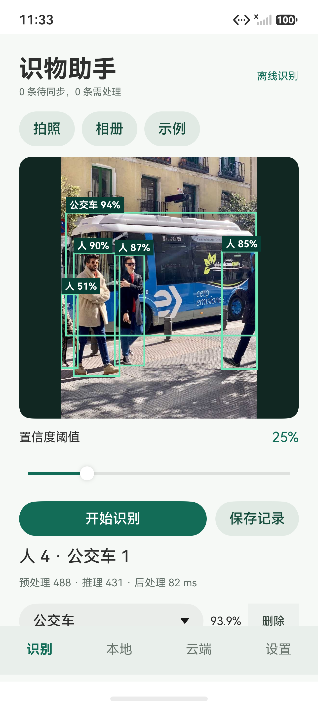
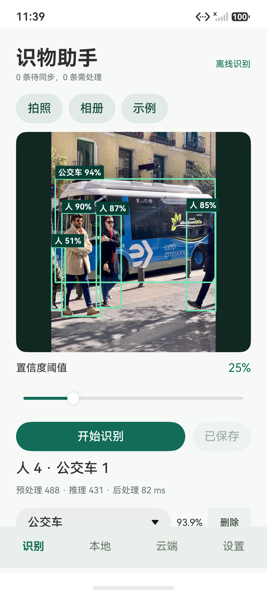

# HarmonyOS 智能物品识别助手

基于 ArkTS / ArkUI、C++ N-API 和 ONNX Runtime 的端侧物品识别应用，配套 FastAPI / SQLite 后端。使用官方 YOLOv13n 预训练模型识别 COCO 80 类物品，包括瓶子、杯子、手机、键盘、书本、人物和车辆。

本项目自行实现应用页面、预处理/后处理、本地记录、同步协议和模型管理，复用上游模型与推理运行库，开发使用 Codex 辅助。

## 功能

- 系统相册选图、图像方向处理、离线推理、检测框与中文类别展示。
- TaskPool 推理、同步/异步性能对照；类别编辑与检测项删除。
- 本地 RDB、缩略图、重启恢复、持久化待同步队列。
- 设备鉴权、JWT、版本化幂等同步、筛选、分页和统计。
- 模型下载、SHA256 校验、试加载、版本切换与回退。
- 保留相机实现；相机专项测试和 ARM64 真机验收尚未完成。

 

## 目录

| 目录 | 内容 |
| --- | --- |
| `SmartItemAssistant/` | DevEco Studio 工程、ArkTS/C++ 源码、两种 ABI 运行库、内置模型 |
| `backend/` | 本机 API、设备登记和自动化测试 |
| `models/` | 后端分发的模型与 manifest |
| `native/` | 构建需要的 ORT C API 头文件、第三方许可 |
| `scripts/` | 算法测试、桌面参考、模型导出与更新测试工具 |
| `doc/` | 来源、架构、验证说明与部分公开测试证据 |

## 构建应用

验证环境：DevEco Studio SDK 26.0.0.105 / API 26、DevEco CLI 1.3.0-stable、Mate 90 Pro 模拟器（HarmonyOS 7、x86_64、4 CPU / 4 GB）。包含 `x86_64` 和 `arm64-v8a` 运行库，模型与运行库已随源码提供。

```powershell
git clone https://github.com/XBacchus/harmonyos-smart-item-assistant.git
cd harmonyos-smart-item-assistant
# 在 DevEco Studio 打开 SmartItemAssistant 文件夹，安装所需 SDK 并同步依赖。
cd SmartItemAssistant
devecocli build
# 启动模拟器后，用 devecocli device 查看设备标识，再运行：
devecocli run --device 127.0.0.1:5555
```

无签名 debug HAP 位于 `entry/build/default/outputs/default/entry-default-unsigned.hap`，已在上述模拟器验证；真机需要自行配置开发者签名。模型不需要联网即可识别。

应用中选择「相册」→照片→「完成」→「开始识别」→「保存记录」。相册为空时，Debug 版设置页的「保存示例到系统相册」可通过系统授权导入公开示例图；此操作仅保存图片，不预置识别结果。

## 可选：运行同步后端

在仓库根目录执行，需要 Python 3.12：

```powershell
py -3.12 -m venv .venv
.\.venv\Scripts\python.exe -m pip install -r backend/requirements.txt
# 首次登记设备；凭据写入 backend/data/device-<UUID>.json，不输出密钥。
.\.venv\Scripts\python.exe -m backend.provision
.\.venv\Scripts\python.exe -m backend.run
```

服务仅监听 `127.0.0.1:8765`。另开终端，按自己的 DevEco Studio 安装位置设置路径并为模拟器反向转发：

```powershell
$devecoRoot = 'D:\DevEco Studio'
& "$devecoRoot\sdk\default\openharmony\toolchains\hdc.exe" rport tcp:8765 tcp:8765
```

在应用设置页填入自己登记的设备 ID、设备密钥和 `http://127.0.0.1:8765`。Debug 版也可将登记产生的 JSON 送入应用私有目录，再点「读取本机调试配置」：

```powershell
# 将下方路径替换成自己登记产生的文件；请勿公开文件内容。
& "$devecoRoot\sdk\default\openharmony\toolchains\hdc.exe" file send -b com.course.smartitemassistant 'D:\path\device-<UUID>.json' /data/storage/el2/base/haps/entry/files/device-credentials.json
```

`backend/data/` 包含私钥、设备凭据、数据库和滚动日志，不应提交。`/health/live` 检查进程，`/health/ready` 检查数据和模型；服务手动运行，Ctrl+C 停止，不配置自启动。日志上限约 8 MiB，并发上限 32。运行中数据库应通过 SQLite backup API 备份。

## 自动检查

在仓库根目录运行：

```powershell
$env:DEVECO_HOME = 'D:\DevEco Studio' # 按实际安装位置修改
& "$env:DEVECO_HOME\tools\node\node.exe" scripts/test_vision.cjs
.\.venv\Scripts\python.exe -m pytest backend/test_api.py -q
# 可选的桌面/设备数值对照：
.\.venv\Scripts\python.exe -m pip install numpy==1.26.4 onnxruntime==1.20.1 opencv-python-headless==4.11.0.86
.\.venv\Scripts\python.exe scripts/verify_reference.py
```

验证结果和未验证边界见 [验收说明](doc/验收说明.md)。模型导出不属于普通运行的必要步骤，来源、固定版本、许可及复现步骤见 [第三方来源](doc/第三方来源.md)。

## 边界与部署注意事项

- 本项目是课程实验，单张示例图测试不能代表通用准确率；相机与 ARM64 真机未完整验收。
- 后端默认仅本机访问，跨机器部署应另行配置 HTTPS；客户端设备密钥目前保存在私有 preferences，生产用途需安全密钥存储。
- 自动重传在启动、前台网络变化和 15 秒定时器触发；应用被杀死时不会后台上传，重新打开后继续。
- 云端仅同步结构化结果。图片与旧模型尚无自动回收/容量配额，长期运行需要保留策略。
- 本地最多展示 200 条，云端按设备加载后筛选，适合课程规模。
- 模型试加载验证 session 与输入输出契约，不代表未知模型的精度验收。更新演示使用相同模型字节。
- SDK 编译仍有兼容性和异常处理警告；没有宣称零警告或生产级稳定性。

## 开源许可

项目以 [GNU AGPL v3](LICENSE) 开源。YOLOv13 模型及上游素材遵循其上游许可；ONNX Runtime 使用 MIT 许可及其第三方条款；DevEco 生成的部分模板保留 Apache-2.0 声明，许可原文均保留于 `native/licenses/`。复用、修改或通过网络提供服务时，请遵守相应许可证的源码提供义务。
